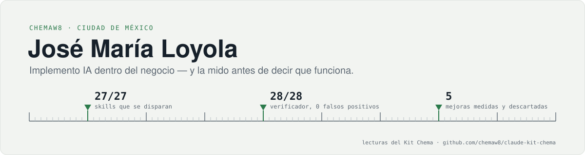

<picture>
  <source media="(prefers-color-scheme: dark)" srcset="assets/banner-oscuro.svg">
  
</picture>

**Líder de implementación de IA · Forward Deployed Engineer** en Innovattia / Ordenaris / Orquestia, Ciudad de México.

Me siento con el área o con el cliente, entiendo el proceso real y entrego algo que funciona con sus datos sucios y sus casos borde. No diapositivas: sistemas en producción, con la medición que dice si sirvieron.

Estudiante de Actuaría en el ITAM. Trabajo con clientes de telecomunicaciones, retail y banca en México.

---

### En qué trabajo

| | Qué | Cómo se sabe que sirve |
|---|---|---|
| **Agentes de IA en campo** | Bot de voz para portabilidad telefónica (LiveKit) que atendió llamadas reales en un centro de contacto | Conversión medida en campo |
| | Campañas conversacionales sobre RCS con IA para **Bait** y los **Charros de Jalisco**; captura por QR con envío RCS automático, montada en vivo en un evento | Tasa de lectura y de respuesta reales, no la promesa del proveedor |
| **Analítica que decide** | Rentabilidad por sucursal de la red de tiendas **Bait (Walmart)**: break-even, modelos estocásticos y criterio de cierres | Para decisiones de dirección |
| | Casos de negocio de MVNO para **Tiendas Neto** y **Farmacias Similares**; máquina de adquisición para una tarjeta de crédito de **BBVA** | Auditados hasta el flujo después de impuestos, no el de la lámina |
| **Herramientas que la gente usa** | Homologador de catálogos de obra contra el tabulador oficial de la **CDMX** | En producción |
| | Dashboards ejecutivos de mensajería A2P (SMS/RCS) para revisión con cliente y pipelines de datos sobre el punto de venta | Revisados con el cliente |
| **El entorno de trabajo con IA** | [Kit Chema](https://github.com/chemaw8/claude-kit-chema), mi propio harness de agentes y mi sistema operativo, [chemarchy](https://github.com/chemaw8/chemarchy-repo) | Ver abajo |

---

### Kit Chema: estándar de calidad para Claude Code, medido

La mayoría de los "kits" para agentes son prosa bien redactada que nadie verificó. **Éste está medido, y las mediciones se vuelven a correr cuando algo cambia:**

| Qué | Medición |
|---|---|
| Las skills se disparan cuando deben | **27/27**, incluidas 7 fronteras entre dominios vecinos, y con las **70 skills** que compiten de verdad, no en laboratorio |
| El que verifica el trabajo, verificado | **28/28, cero falsos positivos**, incluidas 12 trampas escritas por agentes adversarios |
| El council muerde, no decora | Rechazó por unanimidad **una skill que yo mismo propuse** |
| Las reglas también se retiran | La v1.34 **quitó una regla del núcleo** con el criterio de retiro con que había entrado: a los 25 días no movió el patrón que debía corregir |
| Nada sube sin revisión | Gate de push: pruebas en un worktree aislado y un revisor de **otro modelo** antes de cada `git push` |
| Sabe cuándo **no** hacer algo | Cinco propuestas de mejora medidas y **descartadas** en vez de acumuladas |

→ **[github.com/chemaw8/claude-kit-chema](https://github.com/chemaw8/claude-kit-chema)** · núcleo de reglas + 9 skills de dominio + 4 subagentes + 5 hooks + council · en español

---

### Proyectos públicos

| Repo | Qué es |
|---|---|
| [**claude-kit-chema**](https://github.com/chemaw8/claude-kit-chema) | El estándar de arriba: reglas, skills, subagentes, hooks y su banco de mediciones |
| [**chemarchy-repo**](https://github.com/chemaw8/chemarchy-repo) | Repositorio pacman firmado de chemarchy, mi sistema operativo personal sobre Arch Linux |
| [**aureus-quant-engine**](https://github.com/chemaw8/aureus-quant-engine) | Motor de backtesting y paper trading cuantitativo, tipado y probado: ensamble bayesiano de señales y detección de régimen con HMM |

---

### Cómo trabajo

- **Medir antes que opinar.** Si una afirmación mueve una decisión, va con su número y su fuente. "Se siente más rápido" no es un dato.
- **Terminado significa verificado.** Código ejecutado, cifras recalculadas, fuentes abiertas. Un "listo" falso cuesta más que un "me faltó esto".
- **Evaluación crítica antes que complacencia.** Detectar un error en la propuesta de quien me pide algo y callarlo es el peor fallo posible.
- **Esfuerzo proporcional al riesgo.** No todo merece un panel de revisión; lo que va a dirección o mueve dinero, sí.

---

### Herramientas

---

Actuaría @ ITAM · Ciudad de México · <a href="https://github.com/chemaw8/claude-kit-chema">Kit Chema</a>
